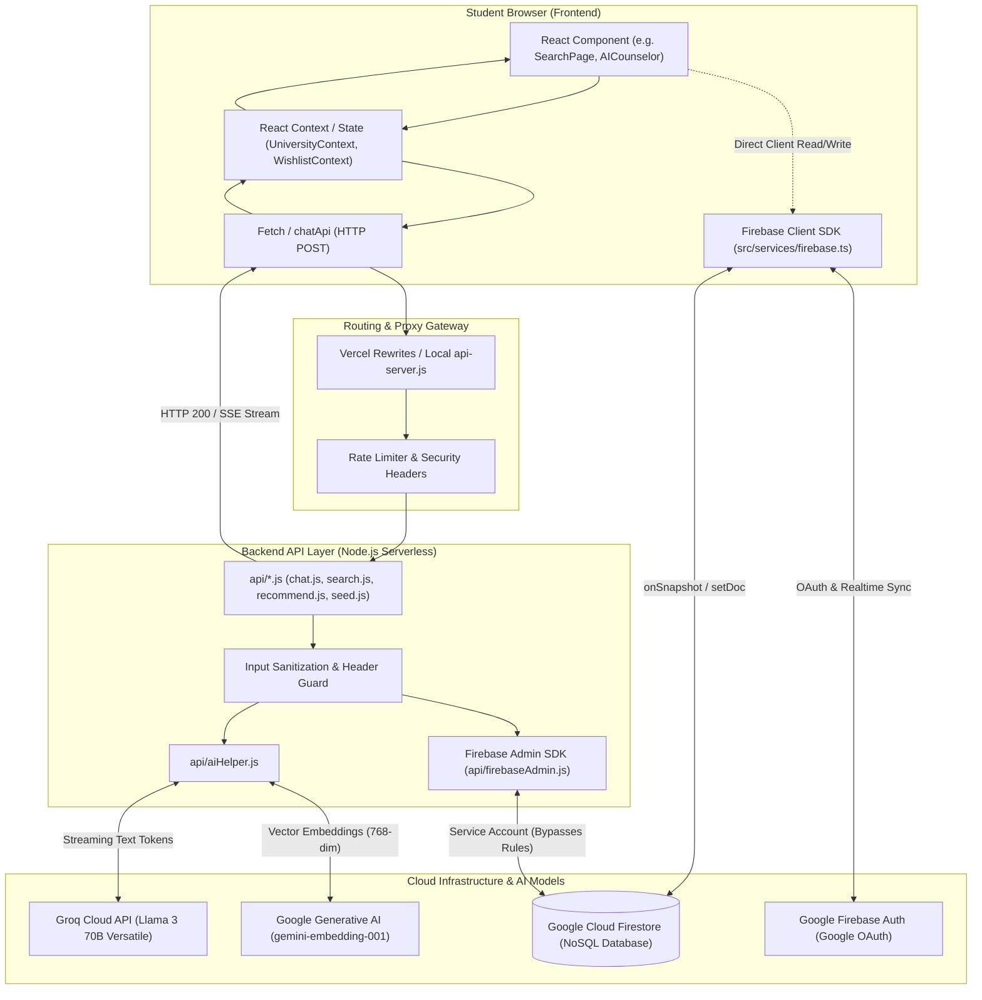

# EduDiscovery — Backend Architecture & Engineering Guide

**Document Purpose:** Complete, beginner-friendly explanation of EduDiscovery's backend systems, data pipelines, API endpoints, and cloud architecture.  
**Audience:** Students, Junior Full-Stack Engineers, and Technical Auditors.  
**Repository:** EduDiscovery (`c:\Users\bhara\OneDrive\Documents\Antigravity\app`)  

---

## 1. End-to-End System Architecture

In EduDiscovery, the system is divided into two distinct halves:
1. **The Client (Frontend):** Runs inside the student's browser on their phone or laptop. It is built using **React 18, Vite, and TypeScript**.
2. **The Server (Backend & Cloud):** Runs remotely on **Vercel Serverless Functions** (or local Express via `api-server.js`), communicating with **Google Cloud Firestore**, **Groq AI (Llama 3)**, and **Google Gemini (Embeddings)**.

### Architectural Request & Data Flow Diagram



---

## 2. Comprehensive API Endpoint Catalog

EduDiscovery exposes 7 server-side endpoints located inside the `api/` directory. The following table describes every parameter, validation check, security guard, and internal behavior.

| Endpoint | Method | Frontend Caller | Payload / Query | Validation Performed | Auth Guard | Services Called | Persistence | Failure Handling | Abuse / Security Risks |
| :--- | :--- | :--- | :--- | :--- | :--- | :--- | :--- | :--- | :--- |
| `/api/chat` | `POST` | `src/services/api/chatApi.ts` via `AICounselor.tsx` | Body: `{ message: string, history: Array, collegeContext: Object }` | Checks `message && typeof message === 'string' && message.trim()`. Max length 1,000 chars. | None (Public) | Groq Cloud (`llama-3.3-70b-versatile`) | None (History stored in browser `localStorage`) | Returns HTTP 400 (`{ reply: string }`) or 500 (`{ error: string }`) | Token burn via rapid chat spam; Prompt injection via crafted queries. |
| `/api/search` | `POST` | `src/pages/SearchPage.tsx` | Body: `{ query: string, limit: number, filters: Object }` | None on `query` length or emptiness (causes 500 if blank). Sanitizes numbers. | None (Public) | Google Gemini (`gemini-embedding-001`), Groq, Firestore (`colleges`) | Reads `colleges` collection | Generic 500 error catch block; fallback to text match | API quota burn on empty/spam requests (BUG-07); pre-filter skips budget (BUG-04). |
| `/api/recommend` | `POST` | `src/pages/HomePage.tsx` | Body: `{ universities: Array, userProfile: Object, userId: string }` | Validates `Array.isArray(universities)`. | Insecure (Accepts caller-provided `userId`) | Groq Cloud, Firestore (`users/{userId}`) | Reads user doc; does not write | Fallback to rule-based slice | IDOR vulnerability (SEC-03); heavy payload (150KB upload on every page load). |
| `/api/quiz-reasoning`| `POST` | `src/pages/QuizResultPage.tsx` | Body: `{ answers: Object, topColleges: Array }` | Requires `answers && topColleges`. | None (Public) | Groq Cloud (`llama-3.3-70b-versatile`) | None (Transient calculation) | Returns fallback mock analysis if Groq fails | LLM hallucination; malformed markdown JSON parsing error (BUG-10). |
| `/api/seed` | `POST` | `src/pages/AdminSeedPage.tsx`, scripts | Body: `{ colleges: Array }`, Header: `X-Seed-Secret` | Checks `colleges && Array.isArray(colleges)`. | Fails Open if `SEED_SECRET` unset (SEC-01) | Google Gemini, Firestore (`colleges` batch write) | Overwrites all `colleges` documents & vector embeddings | Returns 400/403/500 | Database wipe / injection of fraudulent college records; quota exhaustion. |
| `/api/health` | `GET` | Monitoring & uptime bots | None | None | None | Node.js process | None | Returns `{ status: "ok" }` | None. |
| `/api/universities` | `GET` | Direct API clients | Query: `?city=&branch=` | Query param sanitization | None (Public) | Firestore (`colleges`) or local static fallback | None | Returns array of colleges | Potential Firestore read quota spike under heavy traffic. |

---

## 3. Detailed Trace of Key Business Flows

### Flow 1: User Authentication (Signup, Login, Logout)
- **Files Involved:** [`src/services/firebase.ts`](file:///c:/Users/bhara/OneDrive/Documents/Antigravity/app/src/services/firebase.ts), [`src/contexts/AuthContext.tsx`](file:///c:/Users/bhara/OneDrive/Documents/Antigravity/app/src/contexts/AuthContext.tsx), [`src/components/Navbar.tsx`](file:///c:/Users/bhara/OneDrive/Documents/Antigravity/app/src/components/Navbar.tsx)
- **Step 1:** Student clicks "Sign In with Google" on `Navbar.tsx` (Line 185).
- **Step 2:** Calls `signInWithGoogle()` in `AuthContext.tsx` (Line 42), which executes `signInWithPopup(auth, googleProvider)` using Firebase Client SDK.
- **Step 3:** Google OAuth popup displays. Upon successful authentication, Firebase Auth returns a `UserCredential` object containing the user's `uid`, `email`, `displayName`, and `photoURL`.
- **Step 4:** In `AuthContext.tsx` (Line 52), `onAuthStateChanged` fires. It attempts to fetch or create a profile document at `firestore.collection('users').doc(user.uid)`.
- **Step 5:** React state `currentUser` is updated, triggering a re-render of `Navbar` to display the student's avatar.
- **Step 6 (Logout):** Calling `logout()` triggers `signOut(auth)`. `currentUser` is set to `null`, clearing user state across the app.

---

### Flow 2: AI-Powered Semantic College Search
- **Files Involved:** [`src/pages/SearchPage.tsx`](file:///c:/Users/bhara/OneDrive/Documents/Antigravity/app/src/pages/SearchPage.tsx), [`api/search.js`](file:///c:/Users/bhara/OneDrive/Documents/Antigravity/app/api/search.js), [`api/aiHelper.js`](file:///c:/Users/bhara/OneDrive/Documents/Antigravity/app/api/aiHelper.js)
- **Step 1:** User types "affordable computer science college with good placements in Tirupati" into `SearchPage.tsx`.
- **Step 2:** A 600ms debounce timer in `SearchPage.tsx` fires, issuing `POST /api/search` with `{ query, limit: 12, filters }`.
- **Step 3:** Inside `api/search.js` (Line 25), the backend passes the query to Groq LLM to extract search intent:
  ```json
  { "branch": "CSE", "maxBudget": 100000, "city": "Tirupati", "keyPriorities": ["placements"] }
  ```
- **Step 4:** Concurrently, `api/search.js` calls Gemini (`gemini-embedding-001`) via `embeddingModel.embedContent(query)` to convert the search string into a 768-dimensional mathematical vector.
- **Step 5:** The server loads college candidate documents from Firestore (or memory) and calculates the **Cosine Similarity** between the query vector and pre-computed college vectors.
- **Step 6:** Filtering logic filters by city and branch, sorts by similarity score, and returns an array of matched `University` objects with a generated `aiReason` sentence.
- **Step 7:** `SearchPage.tsx` sets `displayResults`, rendering the matching cards with green relevance badges.

---

### Flow 3: AI Counselor Conversational Stream
- **Files Involved:** [`src/components/chat/AICounselor.tsx`](file:///c:/Users/bhara/OneDrive/Documents/Antigravity/app/src/components/chat/AICounselor.tsx), [`src/services/api/chatApi.ts`](file:///c:/Users/bhara/OneDrive/Documents/Antigravity/app/src/services/api/chatApi.ts), [`api/chat.js`](file:///c:/Users/bhara/OneDrive/Documents/Antigravity/app/api/chat.js)
- **Step 1:** Student sends: *"What are the cutoff ranks for NRI Institute CSE?"* in `ChatWindow.tsx`.
- **Step 2:** Message is appended to client `messages` state and persisted into `localStorage.setItem('edudiscovery_counselor_chat', ...)`.
- **Step 3:** `chatApi.ts` calls `fetch('/api/chat', ...)` with `Accept: text/event-stream`.
- **Step 4:** Inside `api/chat.js` (Line 45), the server detects mentioned colleges ("NRI Institute") and injects verified college statistics (cutoffs, fees, placements) into the Groq system prompt.
- **Step 5:** Groq returns an async token stream (`groq.chat.completions.create({ stream: true, ... })`).
- **Step 6:** As each word is generated, `api/chat.js` writes `res.write('data: ' + JSON.stringify({ text: chunk }) + '\n\n')`.
- **Step 7:** The browser's `ReadableStreamDefaultReader` receives byte chunks, decodes them, and updates the chat bubble character by character in real-time.

---

### Flow 4: Wishlist Shortlisting & Firestore Synchronization
- **Files Involved:** [`src/components/cards/UniversityCard.tsx`](file:///c:/Users/bhara/OneDrive/Documents/Antigravity/app/src/components/cards/UniversityCard.tsx), [`src/contexts/WishlistContext.tsx`](file:///c:/Users/bhara/OneDrive/Documents/Antigravity/app/src/contexts/WishlistContext.tsx)
- **Step 1:** Student clicks the Heart icon on a college card.
- **Step 2:** Calls `toggleWishlist(university)` in `WishlistContext.tsx` (Line 60).
- **Step 3:** The context optimistically updates its in-memory `wishlist` array state so the heart icon immediately turns red without lag.
- **Step 4:** `WishlistContext` checks if `currentUser` is authenticated.
  - If authenticated: Executes `setDoc(doc(db, 'users', user.uid), { wishlist: updatedList }, { merge: true })`.
  - If unauthenticated: Saves the array to `localStorage.setItem('edudiscovery_guest_wishlist', ...)`.
- **Step 5:** `showToast('Added to your shortlisted colleges', 'success')` displays a confirmation banner.

---

### Flow 5: College Comparison Engine
- **Files Involved:** [`src/pages/ComparePage.tsx`](file:///c:/Users/bhara/OneDrive/Documents/Antigravity/app/src/pages/ComparePage.tsx), [`src/utils/intelligenceEngine.ts`](file:///c:/Users/bhara/OneDrive/Documents/Antigravity/app/src/utils/intelligenceEngine.ts)
- **Step 1:** User selects two colleges (e.g. SRM AP vs NRI Institute).
- **Step 2:** For each college, `ComparePage` invokes `computeROI(college)` and `computeValueScore(college)`.
  - **ROI Formula:** `(Average Package / Total 4-Year Tuition Fee) * Weighting Factor`.
  - **Value Score:** Multi-criteria weighted average of NAAC Grade, NIRF ranking, placement percentage, and faculty student ratio.
- **Step 3:** Recharts renders comparative bar charts (Average Package LPA) and fee comparison curves.
- **Step 4:** Sub-component `AIVerdict` evaluates the delta between the two colleges' scores and generates a recommendation paragraph stating which college is mathematically superior for the student's priorities.

---

### Flow 6: Career & College Personality Quiz
- **Files Involved:** [`src/pages/QuizPage.tsx`](file:///c:/Users/bhara/OneDrive/Documents/Antigravity/app/src/pages/QuizPage.tsx), [`src/pages/QuizResultPage.tsx`](file:///c:/Users/bhara/OneDrive/Documents/Antigravity/app/src/pages/QuizResultPage.tsx), [`api/quizReasoning.js`](file:///c:/Users/bhara/OneDrive/Documents/Antigravity/app/api/quizReasoning.js), [`src/utils/quizAgent.ts`](file:///c:/Users/bhara/OneDrive/Documents/Antigravity/app/src/utils/quizAgent.ts)
- **Step 1:** Student answers 8 personality and aptitude questions (e.g. math preference, coding interest, corporate vs research inclination).
- **Step 2:** `quizAgent.ts` evaluates the response vector and assigns percentage affinities to engineering branches (CSE, AI/ML, ECE, Mechanical, Data Science).
- **Step 3:** Results are saved to `localStorage.setItem('edudiscovery_quiz_profile', ...)` and the student is routed to `/quiz/results`.
- **Step 4:** `QuizResultPage.tsx` sends `POST /api/quiz-reasoning` with the answer payload.
- **Step 5:** Groq analyzes the answers and returns personalized career pathways, recommended electives, and a curated list of top colleges in AP matching their temperament.

---

### Flow 7: Rank Predictor Calculation
- **Files Involved:** [`src/pages/PredictorPage.tsx`](file:///c:/Users/bhara/OneDrive/Documents/Antigravity/app/src/pages/PredictorPage.tsx), [`src/utils/predictorEngine.ts`](file:///c:/Users/bhara/OneDrive/Documents/Antigravity/app/src/utils/predictorEngine.ts)
- **Step 1:** Student enters their AP EAPCET rank (e.g. `12450`), category (`BC-B`), and desired branches (`CSE, IT`).
- **Step 2:** Pure client-side execution in `predictorEngine.ts`: Compares the student's rank against historical closing ranks stored in each college's `cutoffRank` property.
- **Step 3:** Computes an admission probability band:
  - **Safe Chance (85%+):** Student's rank is at least 15% better than the historical closing rank.
  - **Moderate Chance (50-84%):** Student's rank is within +/- 15% of the closing rank.
  - **Reach / Dream (<50%):** Student's rank is above the closing rank.
- **Step 4:** Results are categorized into tabs: "High Probability", "Moderate", and "Ambitious Dreams", with direct links to view college details or add to wishlist.

---

### Flow 8: Database Vector Seeding Pipeline
- **Files Involved:** [`src/pages/AdminSeedPage.tsx`](file:///c:/Users/bhara/OneDrive/Documents/Antigravity/app/src/pages/AdminSeedPage.tsx), [`api/seed.js`](file:///c:/Users/bhara/OneDrive/Documents/Antigravity/app/api/seed.js)
- **Step 1:** Admin visits `/admin/seed` and clicks "Run Vector Seed Script".
- **Step 2:** Client sends `POST /api/seed` with `X-Seed-Secret` header and `{ colleges: [...] }`.
- **Step 3:** `api/seed.js` initializes `firebaseAdmin` and iterates through each college object.
- **Step 4:** For each college, it creates a descriptive text block combining college name, city, courses, NAAC rating, average package, and facilities.
- **Step 5:** Calls `gemini-embedding-001` to generate a 768-float embedding vector.
- **Step 6:** The vector array is attached to the college object as `embedding: [0.024, -0.118, ...]`.
- **Step 7:** Executes a Firestore batch write committing all documents to the `colleges` collection.
- **Step 8:** Returns `{ success: true, seeded: 48 }` to the frontend, which triggers a confetti explosion and logs completion in the terminal UI.

---

## 4. Master Backend Concepts Explained for Beginners

### 1. Frontend vs. Backend
- **Concept:** The frontend is the user interface running on the user's phone or computer (HTML, CSS, React components). Anyone can inspect its code using browser DevTools. The backend runs on a private remote server (Node.js, Express, Vercel).
- **In EduDiscovery:** `src/pages/SearchPage.tsx` is the frontend. `api/search.js` is the backend. Your Groq API key and Gemini API key must stay in the backend so students cannot steal your API credits.

### 2. Client SDK vs. Firebase Admin SDK
- **Concept:** 
  - **Client SDK (`firebase/app`, `firebase/firestore`):** Runs in the browser. Subject to security rules. Can only do what the logged-in user is permitted to do.
  - **Admin SDK (`firebase-admin`):** Runs only on the server. Has root administrative privileges, bypassing all Firestore security rules.
- **In EduDiscovery:** `src/services/firebase.ts` uses the Client SDK for Google login and wishlist syncing. `api/firebaseAdmin.js` uses the Admin SDK so backend scripts can seed database records.

### 3. Authentication vs. Authorization
- **Concept:** 
  - **Authentication (AuthN):** *"Who are you?"* (e.g. Proving you are student `rahul@gmail.com` with a Google login).
  - **Authorization (AuthZ):** *"What are you allowed to do?"* (e.g. Rahul can edit his own wishlist, but only an Admin can seed the database).
- **In EduDiscovery:** Authentication works via Firebase Auth in `AuthContext.tsx`. However, Authorization is missing in `AdminSeedPage.tsx` (SEC-02), allowing any regular user to access the admin page.

### 4. Firebase ID Tokens & Server-Side Token Verification
- **Concept:** When a user logs in, Firebase gives the browser a cryptographically signed JSON Web Token (JWT) called an **ID Token**. The frontend sends this token in the HTTP `Authorization: Bearer <token>` header. The backend verifies the signature using `admin.auth().verifyIdToken(token)`.
- **In EduDiscovery:** Currently, `/api/recommend` does not verify ID tokens (SEC-03). Instead, it trusts a raw `userId` in the JSON body, which allows identity spoofing.

### 5. Firestore Collections, Documents, Queries & Rules
- **Concept:** Firestore is a document-oriented NoSQL database. A **Collection** is a folder of records (e.g. `colleges`). A **Document** is a single record (e.g. `colleges/nri-institute`). **Security Rules** govern who can read and write to documents from the browser.
- **In EduDiscovery:** We have two main collections: `colleges` (catalog) and `users` (student profiles and wishlists).

### 6. API Middleware & Request Validation
- **Concept:** Middleware is software that intercepts an incoming HTTP request before it reaches the main business logic to check authorization, rate limits, or valid JSON formatting.
- **In EduDiscovery:** In `api-server.js`, `rateLimiter` and `helmet` act as middleware. However, in `api/search.js`, input validation was omitted, causing empty queries to crash the server with HTTP 500 (BUG-07).

### 7. Environment Variables: Public vs. Server-Only Secrets
- **Concept:** Any variable starting with `VITE_` (e.g. `VITE_FIREBASE_API_KEY`) is automatically compiled into the public JavaScript file that anyone can see. Variables without `VITE_` (e.g. `GROQ_API_KEY`, `SEED_SECRET`) stay strictly on the server.
- **In EduDiscovery:** `VITE_SEED_SECRET` in `AdminSeedPage.tsx` is dangerous because putting `VITE_` in front of a secret exposes it to the public internet (SEC-02).

### 8. Promises, `async`/`await`, and Error Propagation
- **Concept:** An operation that takes time (like fetching data from Groq or Firestore) returns a **Promise**. Using `await` pauses execution until the data arrives. If the operation fails, it throws an error that must be caught using `try { ... } catch (error) { ... }`.
- **In EduDiscovery:** In `api/chat.js`, we use `async`/`await` to handle streaming AI responses and catch errors so the server doesn't crash if Groq is temporarily down.

### 9. React State vs. Persistent Database State
- **Concept:** React State (`useState`) lives only in the browser's temporary RAM. If the user refreshes the page, React state vanishes. Database State (Firestore) lives permanently in Google's cloud servers.
- **In EduDiscovery:** In `QuizPage.tsx`, answers are stored in local React state. If a student accidentally refreshes on question 7, their answers are lost (UI-03).

### 10. Caching, Serverless Cold Starts & Repeated Database Reads
- **Concept:** When an API endpoint hasn't been called in a while, the cloud provider (Vercel) shuts it down. The next request must spin up a fresh Node.js container (a **Cold Start**), taking 1-2 seconds. Any in-memory variables are wiped between cold starts.
- **In EduDiscovery:** `api-server.js` uses an in-memory `Map` for rate limiting. When deployed to Vercel serverless, each request can hit a different instance, rendering in-memory rate limiting useless (ARCH-02).

### 11. AI Prompts, Token Usage, and Embeddings
- **Concept:**
  - **Tokens:** Pieces of words processed by LLMs (~4 characters per token).
  - **System Prompt:** Hidden instructions given to the AI specifying its persona and behavioral rules.
  - **Embeddings:** A mathematical list of floating-point numbers (vectors) representing the semantic meaning of text.
- **In EduDiscovery:** `api/seed.js` computes 768-number embeddings for every college. When a student searches, `api/search.js` computes an embedding of the query and calculates the vector angle (cosine similarity) to find the closest matches.

### 12. HTTP Status Codes & API Response Handling
- **Concept:**
  - `200 OK`: Request succeeded.
  - `400 Bad Request`: Client sent invalid or missing data.
  - `401 Unauthorized` / `403 Forbidden`: Client is not authenticated or not allowed.
  - `404 Not Found`: Resource does not exist.
  - `500 Internal Server Error`: Server code crashed.
- **In EduDiscovery:** Endpoint `api/chat.js` returned `{ reply: "error message" }` on status 400 instead of `{ error: "error message" }`, violating standard REST API conventions (BUG-09).

### 13. Concurrency, Race Conditions, and Stale State
- **Concept:** A race condition occurs when two asynchronous operations happen at almost the same time, and the final state depends on which one finishes last.
- **In EduDiscovery:** If a student rapidly clicks the Heart button on multiple colleges, `WishlistContext.tsx` reads the current wishlist, modifies it in JavaScript, and writes it back to Firestore. Fast concurrent clicks can overwrite and erase previously added colleges (DATA-01).

### 14. Database Consistency, Duplicate Writes & Data Loss Risks
- **Concept:** When data is duplicated across multiple places (e.g. storing full college objects inside both the `colleges` collection and each student's `users.wishlist` field), updates to one do not update the other.
- **In EduDiscovery:** `WishlistContext` copies the entire college object into the user document (PERF-02). If college fees change in `colleges`, the student's saved wishlist retains stale, outdated pricing.
