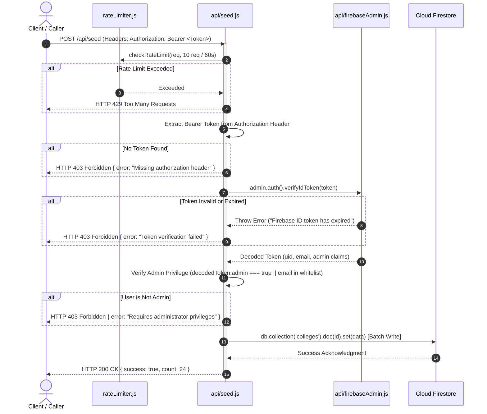

# 5. Backend & Serverless API — EduDiscovery

## 5.1 Backend Topology: Vercel Serverless Functions vs Local Express

EduDiscovery implements a **Serverless-First Backend Architecture**. Instead of running a 24/7 dedicated virtual machine or EC2 instance, backend endpoints are designed as stateless HTTP micro-functions deployed on **Vercel's Serverless Runtime**.

To ensure seamless local development without needing cloud deployment access, the repository includes a dual execution setup:

| Feature / Aspect | Production Runtime (`api/*.js`) | Local Development Runtime (`api-server.js`) |
| :--- | :--- | :--- |
| **Execution Platform** | Vercel Serverless Functions (AWS Lambda abstraction) | Node.js Express server running on `http://localhost:3001` |
| **Lifecycle** | Ephemeral, cold-start on demand, scales to zero | Persistent long-running Node process |
| **Rate Limiter Storage** | Upstash Redis REST API (Distributed cloud store) | In-Memory Map with 5-minute garbage collection |
| **Trigger Command** | Automatic on Git push via Vercel GitHub integration | `npm run dev` (runs Vite + Node via `concurrently`) |
| **Reverse Proxy** | Vercel Edge routing rules configured in `vercel.json` | Vite dev proxy forwarding `/api` requests to port `3001` |

---

## 5.2 The Serverless Endpoints Inventory

All backend logic resides in the root `/api` directory:

```
api/
├── firebaseAdmin.js    # Firebase Admin SDK initialization & credential validation
├── meta.js             # Deployment metadata, health check, and system uptime
├── news.js             # AP EAPCET counseling notifications & circulars API
├── rateLimiter.js      # Upstash Redis & in-memory token bucket rate limiter
└── seed.js             # High-privilege Firestore catalog seeding endpoint
```

### 1. Deployment Health & Metadata Endpoint (`/api/meta`)
- **File:** `api/meta.js`
- **Purpose:** Diagnostic health check reporting API version, current server timestamp, environment mode, and uptime.
- **Use Case:** Used by external monitoring tools and client-side health checks.

### 2. Counseling News & Statutory Circulars (`/api/news`)
- **File:** `api/news.js`
- **Purpose:** Serves structured notifications regarding AP EAPCET registration deadlines, document verification schedules, web option release dates, and seat allotment results.
- **Caching Strategy:** Returns `Cache-Control: public, s-maxage=900, stale-while-revalidate=1800` headers, instructing Vercel's Edge CDN to cache responses for 15 minutes.

---

## 5.3 Administrative Database Seeding & Access Control (`api/seed.js`)

One of the most critical security implementations in EduDiscovery is the protection of the database seeding pipeline. The client application needs a way to populate or refresh official college records in Cloud Firestore, but granting open write access would allow any malicious actor to delete or corrupt university records.

### The Security Vulnerability Solved:
If write rules on `/colleges/{id}` were set to `allow write: if true;`, any user could send a malicious `curl` or Postman request to alter college tuition fees or cutoffs.

### The Solution: Multi-Tier Administrative Verification Pipeline



### Actual Code Implementation (`api/seed.js` Excerpt):
```javascript
// File: api/seed.js
import { getFirebaseAdmin } from './firebaseAdmin.js';
import { checkRateLimit } from './rateLimiter.js';

export default async function handler(req, res) {
  if (req.method !== 'POST') {
    return res.status(405).json({ error: 'Method Not Allowed' });
  }

  // 1. Rate Limiting Check
  const rateLimit = await checkRateLimit(req, { limit: 10, windowMs: 60000 });
  if (rateLimit.exceeded) {
    return res.status(429).json({ error: 'Rate limit exceeded. Try again later.' });
  }

  // 2. Token Extraction
  const authHeader = req.headers.authorization;
  if (!authHeader || !authHeader.startsWith('Bearer ')) {
    return res.status(403).json({ error: 'Forbidden: Missing or invalid authorization token.' });
  }
  const idToken = authHeader.split('Bearer ')[1];

  try {
    const admin = getFirebaseAdmin();
    // 3. Cryptographic Verification via Firebase Admin SDK
    const decodedToken = await admin.auth().verifyIdToken(idToken);

    // 4. Role-Based Access Control (RBAC)
    const isAdmin = decodedToken.admin === true || 
                    decodedToken.email === process.env.VITE_ADMIN_EMAIL;

    if (!isAdmin) {
      console.warn(`[Seeder] User ${decodedToken.email} attempted seed without admin privileges.`);
      return res.status(403).json({ error: 'Forbidden: Requires administrator privileges.' });
    }

    // 5. Authorized Execution: Batch Write to Firestore
    const db = admin.firestore();
    const batch = db.batch();
    // (Batched college catalog writes...)
    await batch.commit();

    return res.status(200).json({ success: true, message: 'Colleges seeded successfully.' });
  } catch (error) {
    return res.status(403).json({ error: `Token verification failed: ${error.message}` });
  }
}
```

---

## 5.4 Production Rate Limiting with Spoofing Protection (`api/rateLimiter.js`)

In serverless environments, standard in-memory rate limiters fail because each request may spawn a new isolated function container. Furthermore, malicious clients frequently spoof headers like `X-Forwarded-For` to bypass IP-based throttling.

EduDiscovery implements a **Production-Grade Serverless Rate Limiter**:
1. **Upstash Redis Integration:** Communicates via lightweight HTTP REST API calls (`UPSTASH_REDIS_REST_URL`), avoiding heavy persistent TCP socket connection overhead in serverless lambdas.
2. **Anti-Spoofing Client IP Resolution:**
   - **Priority 1:** `x-vercel-forwarded-for` — Injected directly by Vercel’s infrastructure edge router; client cannot alter this.
   - **Priority 2:** `cf-connecting-ip` — Injected by Cloudflare when deployed behind Cloudflare CDN.
   - **Priority 3:** Strict leftmost IP sanitization on standard `x-forwarded-for` headers, filtering out private ranges and invalid characters.
