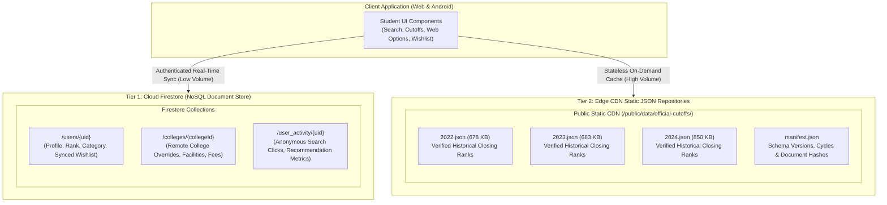
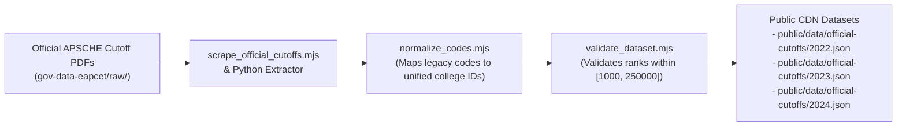

# 6. Database & Data Engineering Deep Dive — EduDiscovery

## 6.1 Database Architecture & Technology Selection

EduDiscovery solves a fundamental challenge in academic admissions applications: **How to deliver massive, multi-year historical datasets alongside dynamic user accounts without incurring high cloud costs or introducing slow latency.**

Instead of forcing all data into a single database paradigm, EduDiscovery deploys a **Hybrid Dual-Tier Data Architecture**:



### Why Cloud Firestore for User Data?
- **Document Model:** User profiles naturally map to JSON-like documents containing scalar attributes (`name`, `email`, `city`) and dynamic arrays (`wishlist: string[]`).
- **Real-Time Synchronization (`onSnapshot`):** When a student adds a college to their wishlist on their Android smartphone, the desktop browser tab instantly updates via Firestore WebSocket listeners without manual page reloads.
- **Offline Persistence:** Firestore automatically caches local snapshots, allowing wishlists and profiles to render even when offline.

### Why Static CDN JSON for Historical Cutoffs (Instead of Database Rows)?
- **Database Cost Analysis:** 3 years of cutoff data across 250+ colleges and 15+ branches represents over **25,000 distinct rank records**. Querying this on Firestore every time a student filters by category would generate millions of billable document reads per month.
- **Latency & Caching:** By compiling verified cutoffs into compressed JSON files on Vercel's global CDN:
  1. Requests return in **< 50 milliseconds** from local edge caches.
  2. The browser caches the file indefinitely via `Cache-Control: public, max-age=31536000, immutable`.
  3. **Zero Firestore read charges** are incurred for cutoff lookups.

---

## 6.2 Cloud Firestore Schema & Security Rules

### Document Model: `/users/{userId}`
```typescript
interface FirestoreUserDocument {
  id: string;               // Firebase Auth UID
  name: string;             // Student full name
  email: string | null;     // Google OAuth or login email
  photoURL: string | null;  // Avatar image URL
  city?: string;            // Home district (e.g., 'Visakhapatnam', 'Guntur')
  eapcetRank?: number;      // Student entrance exam rank (e.g., 14500)
  category?: string;        // Reservation category ('OC', 'BCB', 'SC', etc.)
  preferredBranches?: string[]; // e.g., ['CSE', 'ECE', 'CSM']
  wishlist: string[];       // Array of college IDs, e.g., ['au-college-of-eng', 'jntuk']
  updatedAt: string;        // ISO 8601 timestamp
}
```

### Document Model: `/colleges/{collegeId}`
```typescript
interface FirestoreCollegeDocument {
  id: string;               // Normalized slug (e.g., 'au-college-of-eng')
  name: string;             // Andhra University College of Engineering
  code: string;             // Official EAPCET counseling code (e.g., 'AUCE')
  district: string;         // Visakhapatnam
  region: 'AU' | 'SVU' | 'SW';
  convenerFee: number;      // Statutory annual tuition fee (e.g., 35000)
  autonomous: boolean;      // Autonomous status
  naacGrade: string;        // e.g., 'A++'
  nbaAccredited: boolean;   // NBA status
  establishedYear: number;  // 1955
  facilities: string[];     // ['Hostel', 'Library', 'Sports Complex', 'WiFi']
  officialCutoffsSnapshot?: {
    [branchCode: string]: {
      [categoryGender: string]: number; // e.g., 'BC_B_GIRLS': 4520
    }
  };
}
```

### Firestore Security Rules (`firestore.rules`)
To enforce least privilege access, client writes to the college catalog are blocked entirely, and user data is locked strictly to document owners:

```javascript
// File: firestore.rules
rules_version = '2';
service cloud.firestore {
  match /databases/{database}/documents {

    function isAuthenticated() {
      return request.auth != null;
    }

    function isOwner(userId) {
      return isAuthenticated() && request.auth.uid == userId;
    }

    // 1. College Catalog: Public read, writes strictly blocked to clients
    match /colleges/{collegeId} {
      allow read: if true;
      allow write: if false; // Writes only permitted via Firebase Admin SDK
    }

    // 2. User Profiles: Read/write restricted exclusively to owner
    match /users/{userId} {
      allow read, write: if isOwner(userId);

      match /chat_history/{messageId} {
        allow read, write: if isOwner(userId);
      }
      match /searches/{searchId} {
        allow read, write: if isOwner(userId);
      }
    }

    // 3. Activity Tracking: Restricted to authenticated owner
    match /user_activity/{userId} {
      allow read, write: if isOwner(userId);
    }
  }
}
```

---

## 6.3 Official APSCHE Cutoff Data Engineering Pipeline

A cornerstone of EduDiscovery is its statutory data engineering pipeline located in `gov-data-eapcet/`.

### Source Provenance:
- **Statutory Authority:** Andhra Pradesh State Council of Higher Education (APSCHE) & Department of Technical Education (DTE).
- **Primary Source Documents:** Official counseling cutoff PDF allotment matrices and verified institutional fee orders (G.O.Ms. issued by the Higher Education Department).
- **Document Hash Verification:** Each processed dataset includes cryptographic SHA-256 checksums verifying that transformed JSON records match the government source documents.

### The Data Extraction Pipeline:


### Dimensional Fidelity in Cutoffs:
Unlike rudimentary portals that store only a single number, each cutoff in EduDiscovery maintains full dimensional metadata:
```typescript
interface OfficialCutoffRecord {
  admissionCycle: '2024' | '2023' | '2022';
  collegeId: string;           // 'au-college-of-eng'
  collegeCode: string;         // 'AUCE'
  branchCode: string;          // 'CSE'
  quotaRegion: 'AU' | 'SVU' | 'SW';
  category: 'OC' | 'BCB' | 'SC' | 'ST' | 'OC_EWS';
  genderPool: 'Boys' | 'Girls';
  closingRank: number | null;  // e.g., 2840
  rankStatus: 'published' | 'blank_in_source' | 'unallotted_explicit';
  rawSourceValue: string | null;
  sourceLocation: string | null;
}
```

#### Why `rankStatus` is Critical:
In government matrices, some cells are blank (no seats allotted or category absent). Weak implementations parse blank cells as `0` or exclude them. In EduDiscovery:
- A rank of `0` is never displayed.
- Cells are explicitly marked as `unallotted_explicit` or `blank_in_source`, explaining to the student why a seat was not available for that specific category-branch combination.
