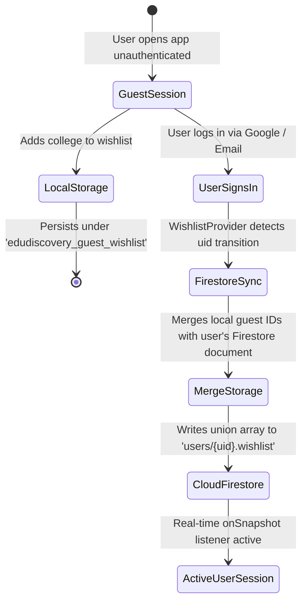

# 4. Frontend Engineering Deep Dive — EduDiscovery

## 4.1 Application Entry Point & Provider Topology

The frontend entry point resides at `src/app/main.tsx`. It initiates the React 19 concurrent root via `ReactDOM.createRoot`:

```tsx
// File: src/app/main.tsx
import React from 'react';
import ReactDOM from 'react-dom/client';
import App from './App';
import AppProviders from './AppProviders';
import '@/index.css';

ReactDOM.createRoot(document.getElementById('root')!).render(
  <React.StrictMode>
    <AppProviders>
      <App />
    </AppProviders>
  </React.StrictMode>
);
```

### The Provider Cascade (`AppProviders.tsx`)
In complex SPAs, uncontrolled context wrapping often causes race conditions or state desynchronization. EduDiscovery explicitly defines strict context dependency ordering in `src/app/AppProviders.tsx`:

```tsx
// File: src/app/AppProviders.tsx
export default function AppProviders({ children }: { children: React.ReactNode }) {
  return (
    <ThemeProvider>
      <AuthProvider>
        <UniversityProvider>
          <WishlistProvider>
            <ToastProvider>
              {children}
            </ToastProvider>
          </WishlistProvider>
        </UniversityProvider>
      </AuthProvider>
    </ThemeProvider>
  );
}
```

#### Why This Exact Nesting Order?
1. **`ThemeProvider` at the Root:** Theme state (`light` vs `dark`) must be established before any UI renders to avoid white flashes on dark mode devices.
2. **`AuthProvider` precedes `WishlistProvider`:** When a user logs in or out, `WishlistProvider` must listen to the updated user ID to determine whether to persist wishlists in `localStorage` (guest) or synchronize them with `users/{uid}` in Cloud Firestore.
3. **`UniversityProvider` precedes `WishlistProvider`:** When hydrating wishlisted college IDs from the database (e.g. `['au-college-of-eng', 'jntuk']`), the `WishlistContext` needs the global university catalog from `UniversityProvider` to map raw IDs to full `University` data objects.

---

## 4.2 Resilient Dynamic Chunk Loading (`lazyWithRetry`)

A persistent issue in Single Page Applications is **Stale Chunk Errors**. When a new deployment is pushed to Vercel, previous JS chunk hashes are purged from the server. If an active user clicks a route, the browser throws an unhandled `TypeError: Failed to fetch dynamically imported module`.

EduDiscovery solves this with a custom resilient dynamic importer in `src/app/App.tsx`:

```tsx
// File: src/app/App.tsx (Lines 8-33)
function lazyWithRetry<T extends React.ComponentType<any>>(
  factory: () => Promise<{ default: T }>
) {
  return lazy(async () => {
    const key = 'edudiscovery_chunk_retry';
    try {
      const component = await factory();
      sessionStorage.removeItem(key); // Succeeded: clear retry marker
      return component;
    } catch (error: any) {
      const isDynamicImportError =
        error?.message?.includes('Failed to fetch dynamically imported module') ||
        error?.message?.includes('Importing a module script failed') ||
        error?.name === 'TypeError';

      const hasRetried = sessionStorage.getItem(key);
      if (isDynamicImportError && !hasRetried) {
        sessionStorage.setItem(key, 'true');
        window.location.reload(); // Refresh browser to fetch latest index.html with new chunk hashes
        return new Promise(() => {}); // Halt execution while reloading
      }
      throw error;
    }
  });
}
```

### Faculty Explanation of `lazyWithRetry`:
- **Problem:** User has tab open with old version `v1.0.0`. You deploy `v1.0.1`. Old chunk `HomePage-B7eb.js` no longer exists on Vercel. Clicking "Home" crashes the app with a blank white screen.
- **Solution:** Our interceptor detects the missing chunk error, sets a one-time session flag, and reloads the browser automatically to fetch the newest HTML manifest. The user experiences an instantaneous, transparent refresh instead of a crash.

---

## 4.3 State Management Architecture: Context vs Local State

EduDiscovery uses **React Context + Custom Hooks** instead of heavy external state libraries like Redux or Zustand.

### 1. `UniversityContext.tsx` — Online-First with Statutory Fallback
Manages the master catalog of colleges:
- When online, queries live Firestore documents via `src/services/collegeQueries.ts`.
- Implements an **in-memory singleton cache** to eliminate duplicate Firestore reads across page navigations.
- If Firestore is unreachable (network offline, quota exhausted), it falls back immediately to verified local statutory records in `src/data/universities.ts`.
- **Reference Preservation:** Only replaces the state array reference if data has genuinely changed, preventing unwanted scroll jumps during background revalidations.

### 2. `WishlistContext.tsx` — Dual-Storage Migration Engine


```tsx
// File: src/contexts/WishlistContext.tsx (Simplified excerpt)
// Real-time synchronization with Firestore
useEffect(() => {
  if (!currentUser?.id || !isFirestoreReady(db)) return;

  const userDocRef = doc(db, 'users', currentUser.id);
  const unsubscribe = onSnapshot(userDocRef, (snapshot) => {
    if (snapshot.exists()) {
      const data = snapshot.data();
      const remoteIds = Array.isArray(data.wishlist) ? data.wishlist : [];
      setWishlistIds(remoteIds);
    }
  });

  return () => unsubscribe();
}, [currentUser?.id]);
```

---

## 4.4 UI Primitives & Accessibility (Tailwind CSS v4 & Radix Slot)

EduDiscovery's UI system leverages modern component design patterns:

### The Polymorphic Button Component (`src/components/ui/button.tsx`)
Built using `@radix-ui/react-slot` and `class-variance-authority`:
- Supports the `asChild` pattern, allowing the button styling and behavior to be delegated to a React Router `<Link>` or standard `<a>` tag without creating invalid nested HTML (e.g., `<button><a>...</a></button>`).
- Enforces a minimum **44px touch target** (`tap-target-44`) complying with WCAG 2.1 mobile accessibility standards.
- Incorporates tactile active scaling (`active:scale-[0.98]`) for native mobile application feel.

### Hardware-Accelerated Animations (`Framer Motion`)
- **Active Navigation Pill:** The navbar utilizes Framer Motion's shared layout animation:
  ```tsx
  <motion.div
    layoutId="activeNavIndicator"
    transition={{ type: 'spring', stiffness: 380, damping: 30 }}
  />
  ```
  When switching between "Home", "Search", and "Web Options", the pill glides smoothly across the screen using hardware-accelerated CSS transforms.
- **Accessibility Safeguard:** Respects `prefers-reduced-motion` at the CSS level in `src/index.css`, disabling transforms and infinite loops for users with vestibular sensitivities.
