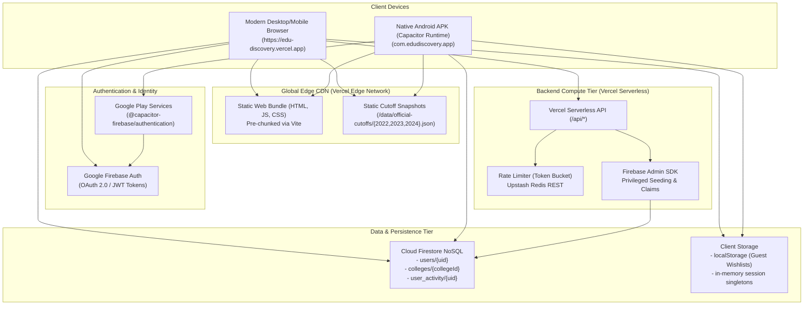
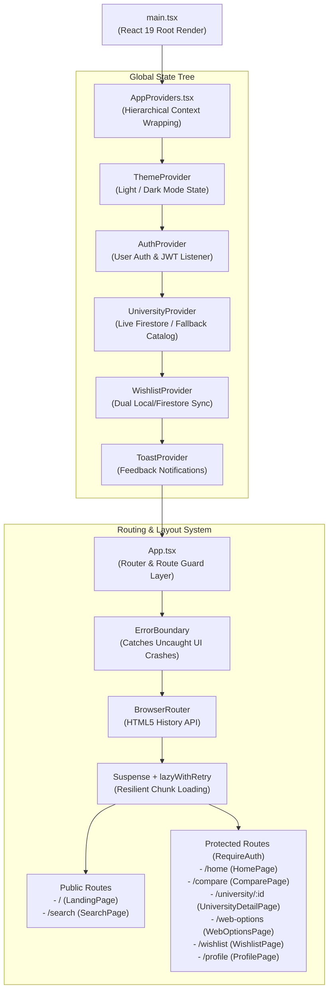
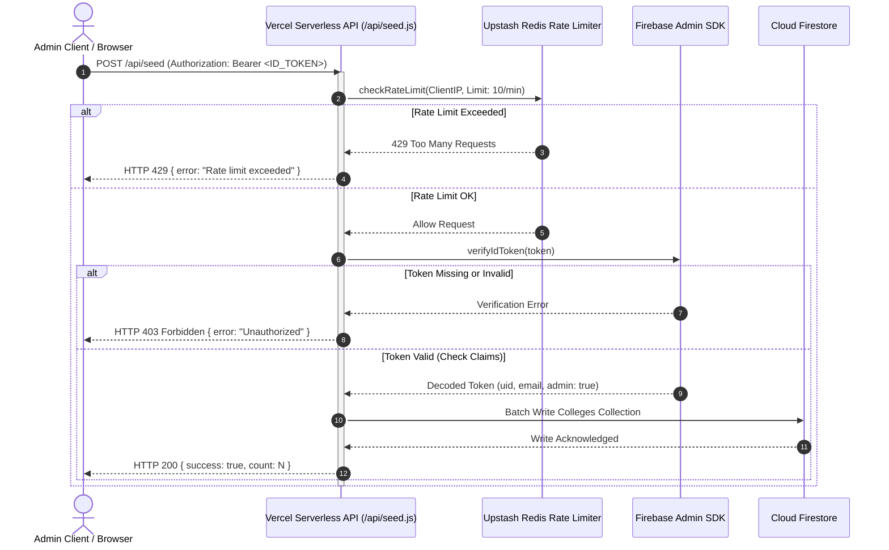
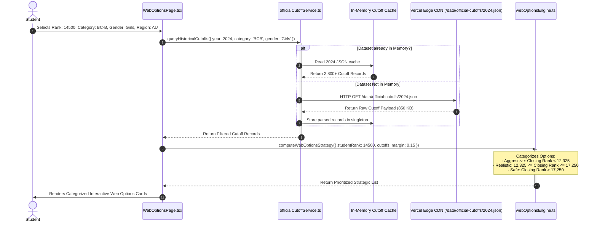
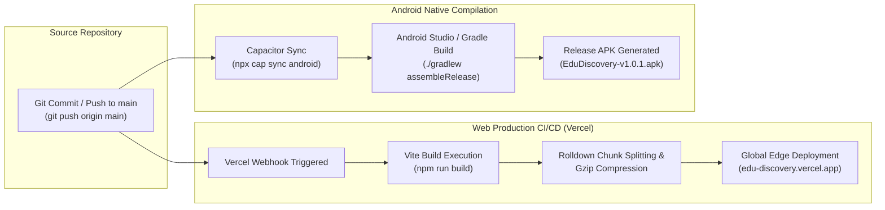

# 3. Complete System Architecture — EduDiscovery

## 3.1 High-Level System Architecture

EduDiscovery is built upon a **decoupled hybrid architecture** where a client-side Single Page Application (SPA) / Native Mobile Container interfaces with three distinct data and service tiers:
1. **Cloud Firestore Tier:** For real-time user profiles, wishlists, and remote college overrides.
2. **Static Edge CDN Tier:** For zero-latency, high-volume historical cutoff data (2022–2024 JSON snapshots) and static media assets.
3. **Serverless Compute Tier:** Vercel Serverless Functions (Node.js) backed by Firebase Admin SDK and Upstash Redis for privileged operations and rate-limited tasks.

---

## 3.2 Frontend Architecture & Component Hierarchy

The frontend follows an **Idiomatic React Architecture** using clean separation of concerns:
- **`src/app/`**: Application bootstrap, global context providers, error boundaries, and top-level route tree.
- **`src/contexts/`**: Global state containers managing Auth, Universities, Wishlists, Theme, and UI Toasts.
- **`src/pages/`**: Route-level screen components dynamically loaded via `lazyWithRetry`.
- **`src/components/`**: Reusable modular UI building blocks divided into UI primitives, layout containers, analytics charts, and cards.
- **`src/services/`**: External communication adapters (Firestore queries, Auth API, Cutoff CDN fetcher).
- **`src/utils/`**: Pure algorithmic computation engines (Web Options engine, cutoff search filters).

---

## 3.3 Backend Serverless Architecture & Execution Pipeline

EduDiscovery utilizes a hybrid backend runtime:
1. **Production Runtime:** Vercel Serverless Functions (`api/*.js`) executed as isolated ephemeral Node.js micro-instances at edge points of presence.
2. **Local Development Runtime:** `api-server.js` running Express on port `3001`, providing local proxy endpoints that execute identical handler logic.

---

## 3.4 Data Flow Architecture: The Web Options Engine Flow

A critical feature evaluators examine is how student inputs (Rank, Reservation Category, Gender Pool, and Target Branches) travel through the system to produce prioritized admission options:

---

## 3.5 Production Build and Deployment Pipeline

The application is deployed through an automated GitHub-to-Vercel CI/CD workflow combined with local Capacitor Android native compilation:

